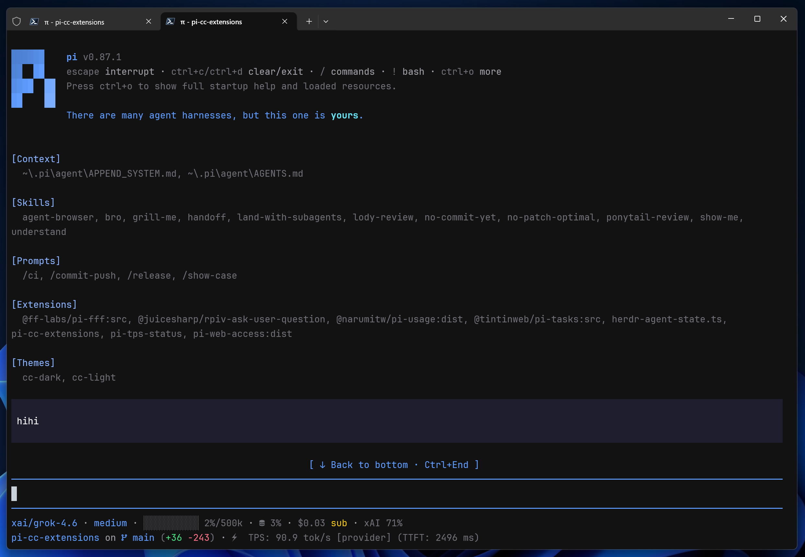
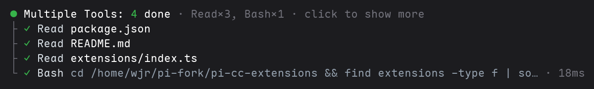
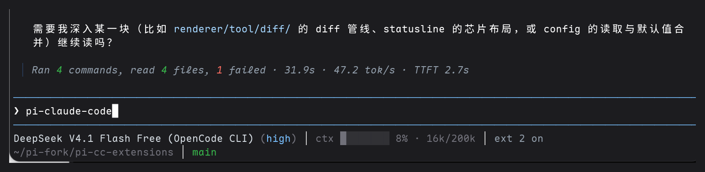
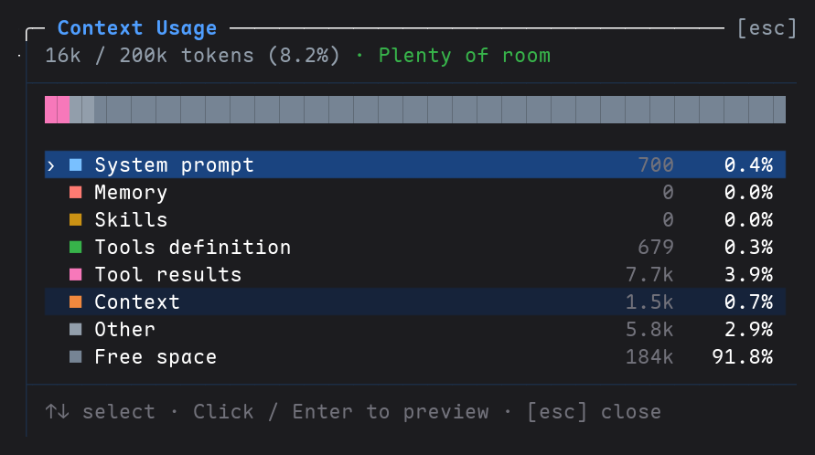

<p align="center">
  <a href="https://pi.dev/packages?name=pi-claude-code"></a>
  <a href="https://www.npmjs.com/package/pi-claude-code"></a>
  <a href="https://www.npmjs.com/package/pi-claude-code"></a>
  <a href="#compatibility"></a>
</p>

<p align="center">
  <a href="./README.md">简体中文</a> · <strong>English</strong>
</p>

# pi-claude-code

> Claude Code's terminal feel, inside Pi: tool cards and collapsing, rich diffs,
> a compact turn view, a two-line statusline and six themes. No extra built-in
> tools — install and `/reload`.

**Why install it**

- **Tool output stops flooding the screen**: Read / Bash / Edit / Write collapse to
  a one-line summary; long output shows `… +N more lines` and expands on click.
- **Diffs you can actually read**: inline highlights for edit / write, side-by-side
  layout, word wrap and `⋮ N lines` gaps; WSL and Windows paths resolve the same
  way as the official tools.
- **Two densities**: `on` for roomy cards, `compact` for dense turns, `off` to hand
  rendering back to Pi.
- **Small conveniences**: `/context` breakdown, `/loaded` resource inventory,
  `@` references to past sessions / subagents, clipboard image paste.

## Install

```bash
pi install npm:pi-claude-code

# GitHub
pi install git:github.com/111222333huantong/pi-claude-code
```

Run `/reload` after installation.

When installing manually with npm, add `--omit=optional` to skip `pi-paster`'s
optional `sharp` dependency (large; only affects some image resizing, the main
paste path still works):

```bash
npm install --omit=optional pi-claude-code
```

## Preview

<a href="https://github.com/user-attachments/assets/6c858000-fdad-43f9-957f-4d0278648498"></a>

Click the cover to play the demo video

**Tool cards and collapsing**: Read / Bash calls in one turn merge into a group; the
header reports the group's **total time**, each row its output volume (`12 lines` /
`3 matches`), and `click to show more` expands it.



**Compact mode**: at turn end, one line summarising commands, files, failures, time, tok/s and TTFT.



**`/context`**: usage breakdown with right-aligned token and percentage columns plus cache-hit stats; Enter previews the selected row.

<p align="center"></p>

## Features

| Feature                     | Description                                                                               | Entry point                                     |
| --------------------------- | ----------------------------------------------------------------------------------------- | ----------------------------------------------- |
| Claude Code UI              | Tool summaries, expand/collapse, rich edit/write diffs, and `on` / `compact` / `off` modes | `/ccstyle`                                      |
| Diagnostics                 | Versions, patch-chain order, compat drift, footer owner and config paths                  | `/ccstyle diag`                                 |
| Markdown enhancements       | Mermaid dialects and circled-number conversion                                            | Automatic; turn off with `enableMarkdownEnhance: false` |
| Fullscreen mode             | Tool card/group expand and collapse on click, previews, hover highlight, and a back-to-bottom button | `TUIMODE=fullscreen` or `--tui-mode fullscreen` |
| Settings panel              | `Style / Features / UI / Diff / Thinking / Footer` tabs                                   | `/ccstyle`                                      |
| Context inspection          | Usage breakdown and previews for the system prompt, memory, skills, tools definition, and messages | `/context`                                      |
| Session/Subagent references | Search and inject effective context from previous Sessions or existing SubAgents          | `@`                                             |
| Loaded resources            | Animated mascot header with a Loaded resource panel                                       | `/loaded`                                       |
| Image paster                | Pasted/dropped image paths become first-class attachments with collapsible history previews | Automatic                                     |
| Clipboard paste             | Ctrl+V pastes clipboard images or text (Windows only); images become attachments          | Automatic (Windows)                             |
| Path hyperlinks             | File paths in tool titles become clickable OSC8 links (zero width change)                 | `/ccstyle` Features tab, off by default         |
| Statusline (this fork)      | Two-line footer: model/ctx/cost/run/mcp/ext + cwd/git, plain text, theme-aware                | `/statusline`                                   |
| Status bar (upstream)       | Shows model, context, cache, cost, the conversation token total, and git; also works with `@narumitw/pi-usage` for live quota. Git/cache/token Nerd Font icons can be turned off | `/ccstyle` (applies when `/statusline` is off)                                      |
| Theme                       | Bundled CC Dark / CC Light / CC Dark HC / CC Light HC / Catppuccin Mocha / Catppuccin Latte themes                   | `/settings` → Theme                             |

> Forked from [`minuque/pi-cc-extensions`](https://github.com/minuque/pi-cc-extensions) (MIT); the statusline and later changes are maintained in this fork.

Renderer snapshots for `on` / `compact` modes: [default](./docs/tool-render-examples-default.md) · [compact](./docs/tool-render-examples-compact.md)

## Configuration

`/ccstyle` behavior is configured through `~/.pi/agent/pi-cc-extensions.json`:

```jsonc
{
  // style
  "mode": "on",                            // on / compact / off
  "excludeRenderers": [],                  // tools keeping the native renderer, matched case-insensitively; Agent always keeps its dedicated renderer

  // features
  "enableSessionReference": true,          // @ session references
  "enableSubagentAutocomplete": true,      // @subagent:[name] completion and delegation hints
  "enableContextCommand": true,            // /context usage check
  "enableAgentSummary": true,              // per-turn tool summary
  "enableWorkingMessage": true,            // Working... bottom token/elapsed
  "enableAliases": true,                   // /clear, /exit aliases
  "enableMarkdownEnhance": true,           // markdown pass: Mermaid dialects and circled-number conversion; false hands it to other extensions
  "enableEditorPrefix": true,              // editor ❯ prefix

  // ui
  "expandedInputMaxLines": 5,              // expanded tool Input lines; overflow shows a footer hint
  "expandedOutputMaxLines": 10,            // expanded tool Output lines; overflow shows a footer hint
  "expandedPreviewMaxLines": 40,           // max lines for expanded TaskList bodies (expanded diffs always show all)
  "toolLabelClip": 0,                      // tool summary path/command clip length; 0 = fit width
  "showStartupHeader": true,               // startup header (logo + tips) toggle
  "stickyUserMessage": true,               // fullscreen: pin a user message's first line once it scrolls off the top edge, until the next one takes over
  "scrollButtonMode": "dock",              // fullscreen: extension dock row / native Pi floating overlay
  "cleanCopy": true,                       // fullscreen selection copy drops tool tree guides, code-box borders and expand hints

  // diff
  "diffViewMode": "auto",                  // layout: auto / split / unified
  "diffIndicatorMode": "bars",             // change indicators: bars / classic / none
  "diffPalette": "theme",                 // palette: theme-adaptive; claude = fixed CC red/green, no highlight on removals
  "diffSplitMinWidth": 120,                // min terminal width for side-by-side columns
  "editDiffCollapsedLines": "auto",        // edit collapse: auto = small diffs in full, large diffs summary-only; number = fixed lines; 0 = summary only
  "writeDiffCollapsedLines": 0,            // write collapse lines; 0 = creation summary only
  "diffWordWrap": true,                    // wrap long diff lines

  // thinking
  "useSummaryTitlesAsThinkingTitle": true, // use latest summary as thinking title
  "previewLines": 3,                       // preview content lines (blanks skipped); 0 hides
  "completedPreviewLines": null,           // completed preview lines; null = follow previewLines, 0 = header only
  "animationIntervalMs": 90,               // title animation interval (ms)
  "thinkingExpandedMaxLines": 200,         // legacy raw preview tail lines; ignored in document mode
  "thinkingLiveSummary": true,             // document mode: two-line collapsed status + full document on expand
  "thinkingSummaryLimit": 0,               // collapsed body lines; 0 = header only (OpenCode-style)
  "thinkingDocumentMaxLines": 0,           // expanded tail window; 0 = full document
  "showRawThinking": false,                // kept for compatibility; document mode always shows full text

  // ui (this fork)
  "showStartupHeader": true,               // startup header (mascot + tips + Loaded) toggle
  "startupAnimation": true,                // play the mascot build-up once per process
  "startupSlogan": "",                     // header slogan (empty hides it)
  "startupSloganColor": "accent",          // slogan color slot: accent / success / warning / error / text / muted
  "quietStartup": true,                    // hide Pi's native startup listing (takes effect next session)
  "scrollStepLines": 3,                    // fullscreen wheel scroll step
  "completionBellAfterSec": 0,             // ring the bell when a turn takes over N seconds, 0 disables
  "liveToolPreview": true,                 // live bash tail preview while running
  "liveToolPreviewLines": 5,               // bash tail preview rows
  "streamThrottleMs": 100,                 // merge streaming redraws every N ms; 0 = redraw every token (high CPU on long replies)

  // features (this fork)
  "enableImagePaster": true,               // image paster: clipboard/dropped images as attachments
  "enableClipboardPaste": true,            // Ctrl+V clipboard paste (Windows only)
  "enablePathHyperlinks": false,           // OSC8 hyperlinks for file paths in titles (off by default)
  "enableEscSteer": true,                  // empty-draft Esc aborts and auto-continues
  "enableDoubleEscClear": true,            // double Esc clears a non-empty draft

  // footer
  "enableCustomFooter": true,              // upstream footer (fallback when /statusline is off)
  "footerTokenRate": true,                 // output rate chip; false hides it
  "footerTokenRateMode": "average",        // average: whole-prompt avg; live: trailing 1s rate
  "footerTokenRateTtft": true,             // append TTFT to the rate chip; false shows tok/s only
  "footerSessionTokens": false,            // conversation token total chip (Nerd Font glyph, Σ in plain text); off by default
  "footerCurrency": "USD",                 // display currency for the footer cost
  "footerCurrencyRate": null,              // display units per 1 cost unit; null changes the symbol only
  "footerNerdIcons": true,                 // Nerd Font glyphs for git/cache/tokens; false = plain text
  "footerGitStatsMode": "working",         // working (default): uncommitted; branch: cumulative net changes
  "footerHiddenKeys": [],                  // hidden chip keys
  "footerLine1Keys": ["model", "context", "cache", "rate", "cost", "tokens", "pi-usage"], // chip order per line; builtins and plugins share one layout
  "footerLine2Keys": ["cwd", "git"],       // cwd: directory and session; git: branch and changes. Either can move to any line
  "footerLine3Keys": [],                   // painted only when a chip is visible
}
```

> `thinkingLiveSummary: true` is the document mode: collapsed shows only the status line (OpenCode-style),
> and expanding renders the full reasoning document without replacing the original text. Set
> `thinkingSummaryLimit` to 1+ to preview the latest N original lines under the status line.
> Provider `**Section title**` blocks are preserved as document sections. Set it to `false` to restore
> the legacy raw preview (`thinkingExpandedMaxLines` only applies there; `showRawThinking` is
> kept for compatibility, while document mode always shows the full text).
> The status word uses text color,
> the current section and body use muted, and the left rule uses dim — the same hierarchy as tool cards
> (title / body / tree line), with no italics. The `│` rule sits in the same column as the tool tree,
> and body text sits in the same column as tool titles and expanded-section bodies. The expanded view
> keeps the same dim left rule; the collapsed view is header-only, with the hover-only `expand` /
> `collapse` action inline at the end of the status line. Hovering brightens the action, and the whole
> block is clickable. While active, the header uses OpenCode's braille snake spinner
> (`⠋ ⠙ ⠹ ⠸ ⠼ ⠴ ⠦ ⠧ ⠇ ⠏`, 90ms per frame) while the status word stays static; the working
> spinner below keeps its own star glyph and verb shimmer.
> For extreme documents, `thinkingDocumentMaxLines` can cap the expanded view to a tail window
> (for example 2000); the default `0` still shows the full text. Streaming uses two gears: normal
> coalescing by `streamThrottleMs`, plus a short catch-up drain once more than 8 frames are pending.

This fork's statusline uses its own file, `~/.pi/agent/statusline.json` (toggle with `/statusline`, or the Features tab in `/ccstyle`). Saved changes apply automatically; `/statusline worktree on|off` toggles the L2 worktree segment immediately:

```js
{
  "enabled": true,       // master switch; off falls back to the upstream footer (then Pi native)
  "showWorktree": true   // show wt <name> on line 2
}
```

> [!TIP]
> **Fullscreen**: expanded diffs always show every line. When expanded Input/Output exceeds the line cap, the footer shows `… +N more lines`; click for the full preview, click again to collapse.

> [!NOTE]
> **Mermaid rendering**: set `markdown.mermaid` to `final` via `~/.pi/agent/settings.json` or `/settings`. Default `streaming` redraws every frame; `final` renders once.

## Local development

```bash
./test.sh            # macOS/Linux; needs node and pi
./test.bat           # Windows; runs test.sh through Git Bash
pi -e .              # one run, does not edit settings.json
```

## Compatibility

- Node.js `>=22.19.0`, Pi `>=1.2.0` (1.4.x / 1.5.x tested)

## FAQ

**Can I install it alongside upstream `pi-cc-extensions` or `pi-claude-code-tui`?**
No. They patch the same renderer components, so they will fight over the screen.
This package already includes the upstream features — install only one.

**Tool output is collapsed by default. Can it stay expanded?**
Click a card to expand it; to widen the limit permanently, raise
`expandedInputMaxLines` / `expandedOutputMaxLines` on the UI tab of `/ccstyle`.

**How do I enable fullscreen?**
Set `TUIMODE=fullscreen` or pass `pi --tui-mode fullscreen`. Drop it to go back.

**The statusline does not show up.**
Run `/statusline on`, then `/reload`. If the upstream footer is enabled too, turn
off `enableCustomFooter` on the Features tab of `/ccstyle` — they are mutually
exclusive.

**High CPU or choppy scrolling during long replies?**
Pi 1.x re-lexes and re-wraps the whole Markdown body on every token (1.5 reuses
render slots, but the full recompute remains). This extension merges
those redraws to roughly 10fps (`streamThrottleMs: 100`). Use `50` for a snappier
stream, `150`/`250` to save more CPU, or `0` to redraw every token.

**Anything to know on Windows / WSL?**
`write` uses Pi's official path resolution, so WSL `/mnt/c/...` lands on the real
C: drive. Ctrl+V clipboard paste is Windows-only and needs `enableClipboardPaste`.

**How do I go back to native rendering?**
`/ccstyle off` restores it immediately; config lives in
`~/.pi/agent/pi-cc-extensions.json` — delete it to reset.

## Recommended companions

| Extension                                | Purpose                                                      |
| ---------------------------------------- | ------------------------------------------------------------ |
| `npm:@arhen/pi-core-subagent`            | Parallel SubAgents, DAG scheduling, worktree isolation (no bottom-docked panel) |
| `npm:@tintinweb/pi-tasks`                | Claude Code-style task tracking and coordination             |
| `npm:pi-mcp-adapter`                     | On-demand MCP tool discovery with lower context usage        |
| `npm:pi-web-access`                      | Web search, URL fetching, GitHub cloning, PDF/video parsing  |
| `npm:@narumitw/pi-usage`                 | Current-account usage for Codex / Copilot / OpenRouter       |
| `npm:@juicesharp/rpiv-ask-user-question` | Multiple-choice questionnaire the model can ask you          |
| `git:github.com/DietrichGebert/ponytail` | Lazy-mode coding: forces the simplest working solution       |

> **Sharing the screen with `@arhen/pi-core-subagent`**: `subagent` spawns keep their built-in plan-graph rendering (human names, no UUIDs); `subagent_status/result/await/reply/steer/cancel` use this package's tool cards (short `runId` + human `taskId`). Its live widget sits above the editor and `/subagents peek` is on demand — no bottom-docked panel. Note: `@tintinweb/pi-tasks`' `TaskExecute` only speaks tintinweb's private RPC and degrades with arhen (tracking works, dispatch verbally). User-aborted tool waits collapse into a dim `Operation aborted` instead of echoing the raw message.

## Contributing

Open an issue from the templates or send a PR; see [`CONTRIBUTING.md`](./CONTRIBUTING.md)
for conventions. Please report security issues privately via [`SECURITY.md`](./SECURITY.md).

## Credits

- Rich diffs are adapted from [`MasuRii/pi-tool-display`](https://github.com/MasuRii/pi-tool-display) (MIT). See [`extensions/renderer/tool/diff/ATTRIBUTION.md`](./extensions/renderer/tool/diff/ATTRIBUTION.md).
- The startup mascot and Loaded panel are ported from [`timvdhoorn/cc-my-pi`](https://github.com/timvdhoorn/cc-my-pi) (MIT), inspired by [`Phoobobo/pi-claude-code-tui`](https://github.com/Phoobobo/pi-claude-code-tui) (MIT).

## License

[MIT](./LICENSE) © minuque (fork annotations, see LICENSE)
