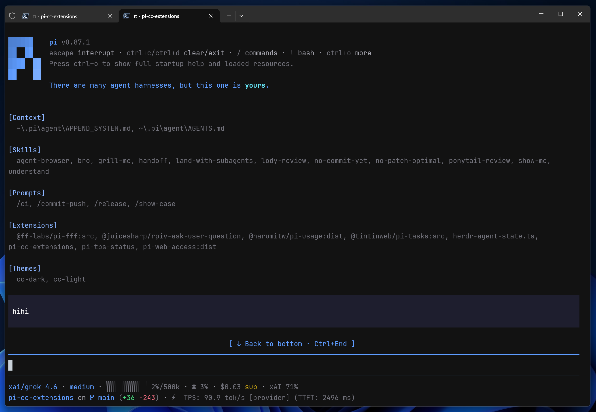
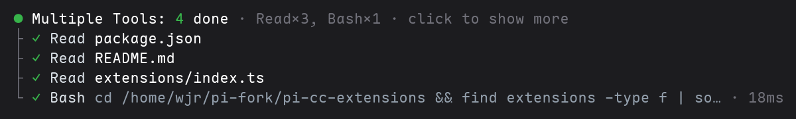
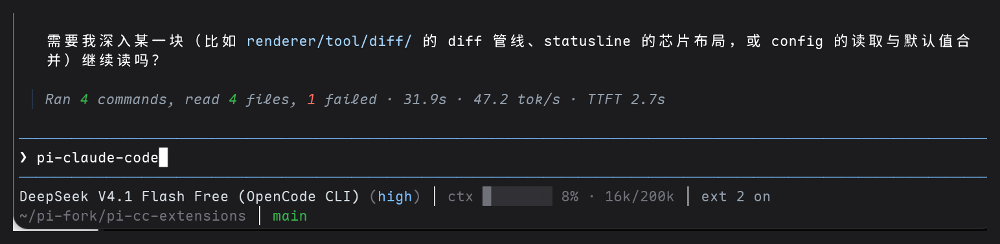
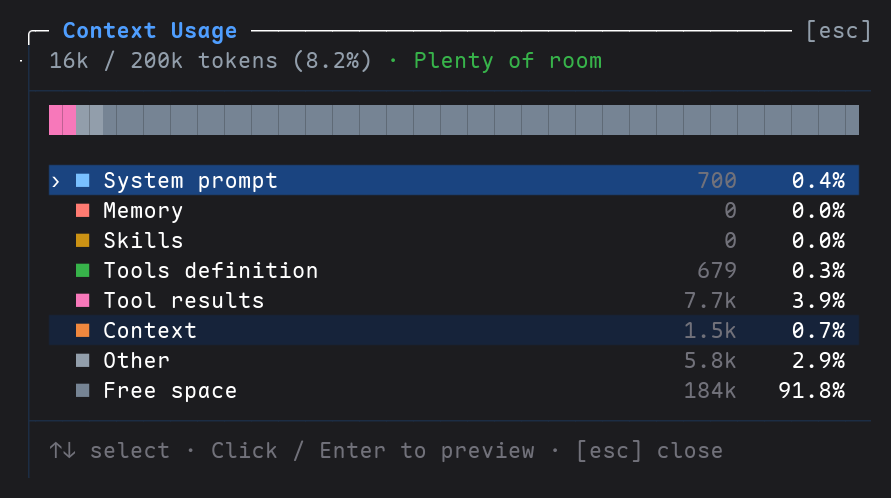

<p align="center">
  <a href="https://pi.dev/packages?name=pi-claude-code"></a>
  <a href="https://www.npmjs.com/package/pi-claude-code"></a>
  <a href="https://www.npmjs.com/package/pi-claude-code"></a>
  <a href="#兼容性"></a>
</p>

<p align="center">
  <strong>简体中文</strong> · <a href="./README.en.md">English</a>
</p>

# pi-claude-code

> 把 Claude Code 的终端观感搬进 Pi：工具卡与折叠、rich diff、compact 紧凑模式、
> 两行状态栏和四套主题。不新增内置工具，装完 `/reload` 即用。

**为什么装它**

- **工具输出不再刷屏**：Read / Bash / Edit / Write 收敛成一行摘要，长输出显示
  `… +N more lines`，单击展开看全量。
- **diff 看得清**：edit / write 行内高亮、左右分栏、自动换行、`⋮ N lines` 省略；
  WSL 与 Windows 路径都按官方语义解析。
- **两种密度**：`on` 宽松卡片、`compact` 紧凑回合视图，`off` 一键还原原生渲染。
- **顺手的小工具**：`/context` 上下文分解、`/loaded` 资源盘点、`@` 引用历史
  session / subagent、剪贴板图片粘贴。

## 安装

```bash
pi install npm:pi-claude-code

# GitHub
pi install git:github.com/111222333huantong/pi-claude-code
```

安装后执行 `/reload`。

## 界面预览

<a href="https://github.com/user-attachments/assets/6c858000-fdad-43f9-957f-4d0278648498"></a>

点击封面播放演示视频

**工具卡与折叠**：一个回合里的 Read / Bash 自动并组，组头报**总耗时**，组内每行报产出
（`12 lines` / `3 matches`），`click to show more` 展开。



**紧凑模式**：回合结束时一行汇总命令数、文件数、失败数、耗时、tok/s 与 TTFT。



**`/context`**：上下文占用分解，token 与百分比两列贴右，附带缓存命中统计，回车预览选中项。

<p align="center"></p>

## 功能

| 功能                  | 说明                                                                            | 入口                                            |
| --------------------- | ------------------------------------------------------------------------------- | ----------------------------------------------- |
| Claude Code UI        | 工具摘要、折叠展开、rich edit/write diff，以及`on` / `compact` / `off` 三种模式 | `/ccstyle`                                      |
| Markdown 增强         | Mermaid 方言渲染、圈数字转半角括号                                                         | 自动生效；`enableMarkdownEnhance: false` 关闭   |
| Fullscreen mode       | 工具卡/group 单击展开与收起、预览、hover 高亮、回到底部按钮                 | `TUIMODE=fullscreen` 或 `--tui-mode fullscreen` |
| 配置面板              | `Style / Features / UI / Diff / Thinking / Footer` 六页签                       | `/ccstyle`                                      |
| 上下文检查            | 查看上下文占用，并预览 System prompt、Memory、Skills、Tools definition 和消息内容 | `/context`                                      |
| Session/Subagent 引用 | 搜索并注入历史 Session 或现有 SubAgent 的有效上下文                             | `@`                                             |
| 资源盘点                  | 动画 mascot 启动头 + Loaded 资源面板，常驻查看命令                                    | `/loaded`                                       |
| 图片粘贴              | 剪贴板/拖拽图片路径变为第一等附件，历史折叠预览                                      | 自动生效                                        |
| 剪贴板粘贴                | Ctrl+V 直粘剪贴板图片或文字（仅 Windows），图片自动转附件                             | 自动生效（Windows）                             |
| 路径超链接              | 工具标题里的文件路径变为可点击 OSC8 链接（零宽度变化）                                | `/ccstyle` Features 页，默认关                  |
| 状态栏（本 fork）         | 两行 footer：model/ctx/cost/run/mcp/ext + cwd/git，无图标纯文字，主题跟随                | `/statusline`                                   |
| 状态栏（上游）            | 显示：模型、上下文、缓存、费用、git并适配 @narumitw/pi-usage 实时显示额度；git/缓存图标可关 Nerd Font | `/ccstyle`（关掉 `/statusline` 后生效） |
| 主题                  | 随包提供 CC Dark / CC Light / Catppuccin Mocha / Catppuccin Latte 四套主题      | `/settings` → Theme                             |

> 本包 fork 自 [`minuque/pi-cc-extensions`](https://github.com/minuque/pi-cc-extensions)（MIT），状态栏及后续改动由本 fork 维护。

`on` / `compact` 两种模式的渲染样例：[默认模式](./docs/tool-render-examples-default.md) · [紧凑模式](./docs/tool-render-examples-compact.md)

## 配置

`/ccstyle` 的行为由 `~/.pi/agent/pi-cc-extensions.json` 配置：

```jsonc
{
  // style
  "mode": "on",                            // on / compact / off
  "excludeRenderers": [],                  // 走原生渲染的工具名，匹配忽略大小写；Agent 始终保留专用渲染器

  // features
  "enableSessionReference": true,          // @ session 引用
  "enableSubagentAutocomplete": true,      // @subagent:[name] 补全与委派提示
  "enableContextCommand": true,            // /context 上下文检查
  "enableAgentSummary": true,              // 每回合工具摘要
  "enableWorkingMessage": true,            // Working... 底部 token/耗时
  "enableAliases": true,                   // /clear、/exit 别名
  "enableMarkdownEnhance": true,           // markdown 转换：Mermaid 方言渲染、圈数字转半角括号；false 让位给其他扩展
  "enableEditorPrefix": true,              // 输入框 ❯ 前缀

  // ui
  "expandedInputMaxLines": 5,              // 展开工具卡 Input 可见行数，超出在末行显示展开提示
  "expandedOutputMaxLines": 10,            // 展开工具卡 Output 可见行数，超出在末行显示展开提示
  "expandedPreviewMaxLines": 40,           // 展开 TaskList 正文最大行数（展开 diff 始终全量）
  "toolLabelClip": 0,                      // 工具摘要 path/command 折叠字符数；0 = 按可用宽度
  "showStartupHeader": true,               // 启动头（logo + tips）开关
  "stickyUserMessage": true,               // fullscreen：userMessage 正文首行滚出视口上沿后钉住，直到下一条指令接手
  "scrollButtonMode": "dock",              // fullscreen：dock 独占行 / native Pi 原生浮层

  // diff
  "diffViewMode": "auto",                  // 布局：auto / split / unified
  "diffIndicatorMode": "bars",             // 变更指示：bars / classic / none
  "diffPalette": "theme",                 // 配色：theme 跟随主题；claude 固定 CC 红绿 + 删行不高亮
  "diffSplitMinWidth": 120,                // 左右分栏的最小终端宽度
  "editDiffCollapsedLines": 24,            // edit 折叠行数；0 仅显示变更统计摘要
  "writeDiffCollapsedLines": 0,            // write 折叠行数，0 仅显示创建摘要
  "diffWordWrap": true,                    // 长 diff 行换行

  // thinking
  "useSummaryTitlesAsThinkingTitle": true, // 用最新摘要作思考标题
  "previewLines": 3,                       // 预览内容行数（空行不占窗口），0 隐藏
  "animationIntervalMs": 90,               // 标题动画间隔（毫秒）
  "thinkingExpandedMaxLines": 200,         // 展开先给尾部行数，再推进一次看全文
  "thinkingLiveSummary": true,             // 活动 thinking 标题扫光 + 按段落累积摘要
  "thinkingSummaryLimit": 5,               // 折叠态保留的最近摘要条数
  "showRawThinking": false,                // 展开态显示原文（调试用）

  // ui（本 fork 增补）
  "showStartupHeader": true,               // 启动头（mascot + tips + Loaded）开关
  "startupAnimation": true,                // 每进程播放一次 mascot 成长动画
  "startupSlogan": "",                     // 启动头 slogan（空串关闭）；独立颜色见下
  "startupSloganColor": "accent",          // slogan 独立色：accent / success / warning / error / text / muted
  "quietStartup": true,                    // 隐藏原生启动资源列表，下会话生效
  "scrollStepLines": 3,                    // fullscreen 滚轮步进
  "completionBellAfterSec": 0,             // 回合超过 N 秒完成时响铃，0 关闭
  "liveToolPreview": true,                 // bash 执行中/落定尾预览开关
  "liveToolPreviewLines": 5,               // bash 尾预览行数

  // features（本 fork 增补）
  "enableImagePaster": true,               // 图片粘贴：剪贴板/拖拽图片转附件
  "enableClipboardPaste": true,            // Ctrl+V 剪贴板粘贴（仅 Windows）
  "enablePathHyperlinks": false,           // 工具标题文件路径 OSC8 超链接（默认关）
  "enableEscSteer": true,                  // 空草稿 Esc 中断后续跑
  "enableDoubleEscClear": true,            // 双击 Esc 清空草稿
  "enableCustomFooter": true,               // 上游 footer（本 fork 状态栏关闭时回退用）
  "footerTokenRate": true,                 // 输出速率芯片；false 隐藏
  "footerTokenRateMode": "average",        // average：整段指令平均（avg）；live：最近 1 秒瞬时（live）
  "footerTokenRateTtft": true,             // 速率芯片是否带 TTFT；false 只显示 tok/s
  "footerCurrency": "USD",                 // 底栏费用的显示币种
  "footerCurrencyRate": null,              // 1 单位费用换成多少显示币种；null 只换符号、不乘倍率
  "footerNerdIcons": true,                 // git/缓存用 Nerd Font 图标；false 为纯文本
  "footerGitStatsMode": "working",         // working（默认）：未提交改动；branch：分支累计净改动
  "footerHiddenKeys": [],                  // 隐藏的芯片 key
  "footerLine1Keys": ["model", "context", "cache", "rate", "cost", "pi-usage"], // 每行芯片顺序；内置项与插件同一套排布
  "footerLine2Keys": ["cwd", "git"],       // cwd：目录和会话名；git：分支和改动。可换到任意行
  "footerLine3Keys": []                    // 有可见芯片才占行
}
```

> `thinkingLiveSummary` 只在 thinking 被隐藏（`Ctrl+T` 或 `hideThinkingBlock: true`）时接管；
> 折叠/展开默认都只显示摘要列表，`showRawThinking: true` 才在展开态显示原文。
> 有 provider 的 `**Section title**` 时优先用标题；没有时按空行/句末换行/500 字/2 秒空闲切块，
> 每块本地提炼一行摘要，不额外调用模型。本地 fallback 会过滤“用户问了什么/我要怎么回答/确保格式”
> 这类元话语和短碎片；过滤后没有有效内容就不生成条目。

本 fork 状态栏走独立文件 `~/.pi/agent/statusline.json`（`/statusline` 开关，`/ccstyle` Features 页亦可切）：

```js
{
  "enabled": true,       // 总闸；false 时回退上游 footer（再关则 Pi 原生 footer）
  "showWorktree": true   // L2 是否显示 wt <name>
}
```

> [!TIP]
> **全屏模式**：展开态 diff 默认最多 2000 行，末尾给 `… N more diff lines · click to render all`，再点一次才全量。Input/Output 超行时末行给 `… +N more lines`，单击看全量，再击收起。

> [!NOTE]
> **Mermaid 渲染**：`markdown.mermaid` 建议设为 `final`（`~/.pi/agent/settings.json` 或 `/settings`）。默认 `streaming` 逐帧重绘，`final` 只渲染最终版。

## 本地开发

```bash
./test.sh            # macOS/Linux，需要 node 和 pi
./test.bat           # Windows，经 Git Bash 运行 test.sh
pi -e .              # 只跑一次，不改 settings.json
```

## 兼容性

- Node.js `>=22.19.0`，Pi `>=1.2.0`

## 常见问题

**能和上游 `pi-cc-extensions` 或 `pi-claude-code-tui` 同时装吗？**
不能。它们 patch 同一批渲染组件，同屏会互相覆盖。本包已包含上游功能，只装这一个。

**工具输出默认折叠，能一直展开吗？**
单击卡片即可展开；想永久放宽可在 `/ccstyle` → UI 页调大
`expandedInputMaxLines` / `expandedOutputMaxLines`。

**fullscreen 怎么开？**
`TUIMODE=fullscreen` 环境变量或 `pi --tui-mode fullscreen`；去掉参数即回普通模式。

**状态栏没出现？**
先 `/statusline on` 再 `/reload`。若同时启用了上游 footer，需要在 `/ccstyle`
Features 页关掉 `enableCustomFooter`——两者互斥。

**Windows / WSL 有什么注意点？**
`write` 走 Pi 官方路径解析，WSL 的 `/mnt/c/...` 会写到对应的 C 盘目录；
Ctrl+V 直粘剪贴板只支持 Windows，且需要 `enableClipboardPaste`。

**升级后不适应，怎么退回原生？**
`/ccstyle off` 立即还原生渲染；配置在 `~/.pi/agent/pi-cc-extensions.json`，
删掉即恢复默认。

## 推荐搭配

| 扩展                                     | 用途                                             |
| ---------------------------------------- | ------------------------------------------------ |
| `npm:@arhen/pi-core-subagent`            | 并行 SubAgent、依赖图调度与工作树隔离（无底部常驻面板） |
| `npm:@tintinweb/pi-tasks`                | Claude Code 风格任务跟踪与协调                   |
| `npm:pi-mcp-adapter`                     | 按需发现 MCP 工具，减少上下文占用                |
| `npm:pi-web-access`                      | 网页搜索、URL 抓取、GitHub 克隆、PDF/视频解析    |
| `npm:@narumitw/pi-usage`                 | 查看当前账号用量（Codex / Copilot / OpenRouter） |
| `npm:@juicesharp/rpiv-ask-user-question` | 模型拿不准时向你提问的选择题面板                 |

> **与 `@arhen/pi-core-subagent` 同屏**：`subagent` 派生调用保留对方自带的计划图渲染（人名标题，无 UUID）；`subagent_status/result/await/reply/steer/cancel` 走本包工具卡（`runId` 短 ID + 人名 taskId）。对方的 live widget 在编辑器上方、`/subagents peek` 按需查看，无底部常驻面板。注意：`@tintinweb/pi-tasks` 的 `TaskExecute` 只认 tintinweb 私有 RPC，换 arhen 后降级（任务跟踪照常，派发改口头指令）。用户中断（esc）的工具等待会收敛为 dim 色 `Operation aborted`，不再复读原文。

## 参与

问题与想法走 issue 模板或直接开 PR；开发约定见 [`CONTRIBUTING.md`](./CONTRIBUTING.md)，
安全问题请走[私密报告](./SECURITY.md)。

## 致谢

- Rich diff 改编自 [`MasuRii/pi-tool-display`](https://github.com/MasuRii/pi-tool-display)（MIT）；详见 [`extensions/renderer/tool/diff/ATTRIBUTION.md`](./extensions/renderer/tool/diff/ATTRIBUTION.md)。
- 启动头 mascot 与 Loaded 盘点移植自 [`timvdhoorn/cc-my-pi`](https://github.com/timvdhoorn/cc-my-pi)（MIT），其灵感来自 [`Phoobobo/pi-claude-code-tui`](https://github.com/Phoobobo/pi-claude-code-tui)（MIT）。

## 许可证

[MIT](./LICENSE) © minuque（fork 续注见 LICENSE）
