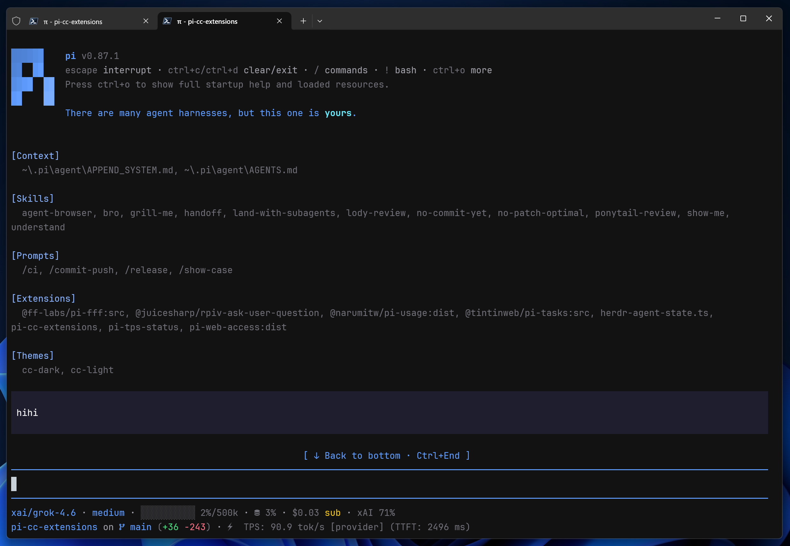
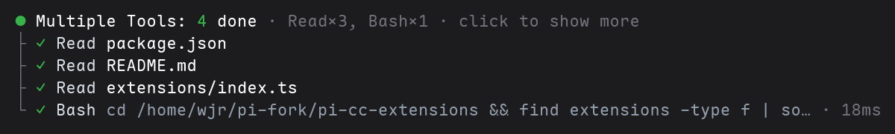
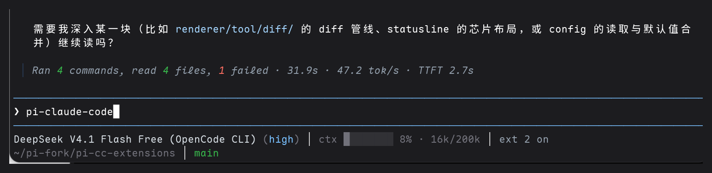
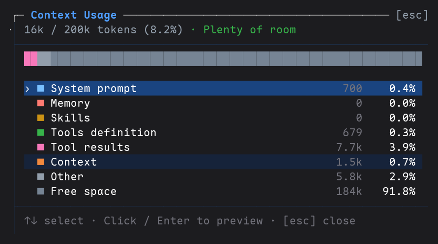

<p align="center">
  <a href="https://pi.dev/packages?name=pi-claude-code"></a>
  <a href="https://www.npmjs.com/package/pi-claude-code"></a>
  <a href="https://www.npmjs.com/package/pi-claude-code"></a>
  <a href="#兼容性"></a>
</p>

<p align="center">
  <strong>简体中文</strong> · <a href="./README.en.md">English</a>
</p>

# pi-claude-code

> 把 Claude Code 的终端观感搬进 Pi：工具卡与折叠、rich diff、compact 紧凑模式、
> 两行状态栏和六套主题。不新增内置工具，装完 `/reload` 即用。

**为什么装它**

- **工具输出不再刷屏**：Read / Bash / Edit / Write 收敛成一行摘要，长输出显示
  `… +N more lines`，单击展开看全量。
- **diff 看得清**：edit / write 行内高亮、左右分栏、自动换行、`⋮ N lines` 省略；
  WSL 与 Windows 路径都按官方语义解析。
- **两种密度**：`on` 宽松卡片、`compact` 紧凑回合视图，`off` 一键还原原生渲染。
- **长会话不卡**：ctx 用量、会话 token、git stats 全部事件驱动缓存，不逐帧扫全
  会话——Pi 跑几个小时也稳定 60fps（上游同型 footer 曾因每帧重扫会话被报 100% CPU）。
- **顺手的小工具**：`/context` 上下文分解、`/loaded` 资源盘点、`@` 引用历史
  session / subagent、剪贴板图片粘贴。

## 安装

```bash
pi install npm:pi-claude-code

# GitHub
pi install git:github.com/111222333huantong/pi-claude-code
```

安装后执行 `/reload`。

手动用 npm 安装时，可加 `--omit=optional` 跳过 `pi-paster` 的可选依赖
`sharp`（体积较大，只影响部分图片缩放，图片粘贴主路径仍可用）：

```bash
npm install --omit=optional pi-claude-code
```

## 界面预览

<a href="https://github.com/user-attachments/assets/6c858000-fdad-43f9-957f-4d0278648498"></a>

点击封面播放演示视频

**工具卡与折叠**：一个回合里的 Read / Bash 自动并组，组头报**总耗时**，组内每行报产出
（`12 lines` / `3 matches`），`click to show more` 展开。



**紧凑模式**：回合结束时一行汇总命令数、文件数、失败数、耗时、tok/s 与 TTFT。



**`/context`**：上下文占用分解，token 与百分比两列贴右，附带缓存命中统计，回车预览选中项。

<p align="center"></p>

## 功能

| 功能                  | 说明                                                                            | 入口                                            |
| --------------------- | ------------------------------------------------------------------------------- | ----------------------------------------------- |
| Claude Code UI        | 工具摘要、折叠展开、rich edit/write diff，以及`on` / `compact` / `off` 三种模式 | `/ccstyle`                                      |
| 诊断                  | 版本、补丁链顺序、compat 漂移、footer 归属与配置路径                             | `/ccstyle diag`                                 |
| Markdown 增强         | 方言 fence 的 Mermaid 渲染（`statediagram`、`classdiagram` 等）、圈数字转半角括号；标准 mermaid 交给 pi | 自动生效；`enableMarkdownEnhance: false` 关闭   |
| Fullscreen mode       | 工具卡/group 单击展开与收起、预览、hover 高亮、回到底部按钮                 | `--tui-mode fullscreen`（pi 1.5 起默认） |
| 配置面板              | `Essentials`（11 项）+ `Advanced`（点开进原分组收其余）                        | `/ccstyle`                                      |
| 上下文检查            | 查看上下文占用，并预览 System prompt、Memory、Skills、Tools definition 和消息内容 | `/context`                                      |
| 会话记录浏览          | 全屏浏览完整会话记录，工具输出全展开；对话区有可展开的 `!` 输出时把键让给 pi | `Ctrl+O`                                        |
| Session/Subagent 引用 | 搜索并注入历史 Session 或现有 SubAgent 的有效上下文                             | `@`                                             |
| 资源盘点                  | 动画 mascot 启动头 + Loaded 资源面板，常驻查看命令                                    | `/loaded`                                       |
| 图片粘贴              | 剪贴板/拖拽图片路径变为第一等附件，历史折叠预览                                      | 自动生效                                        |
| 剪贴板粘贴                | Ctrl+V 直粘剪贴板图片或文字（仅 Windows），图片自动转附件                             | 自动生效（Windows）                             |
| 路径超链接              | 工具标题里的文件路径变为可点击 OSC8 链接（零宽度变化）                                | `/ccstyle` Features 页，默认关                  |
| 状态栏（本 fork）         | 两行 footer：model/ctx/cost/run/mcp/ext + cwd/git，无图标纯文字，主题跟随                | `/statusline`                                   |
| 状态栏（上游）            | 显示：模型、上下文、缓存、费用、本次对话累计 token、git并适配 @narumitw/pi-usage 实时显示额度；git/缓存/token 图标可关 Nerd Font | `/ccstyle`（关掉 `/statusline` 后生效） |
| 主题                  | 随包提供 CC Dark / CC Light / CC Dark HC / CC Light HC / Catppuccin Mocha / Catppuccin Latte 六套主题      | `/settings` → Theme                             |

> 本包 fork 自 [`minuque/pi-cc-extensions`](https://github.com/minuque/pi-cc-extensions)（MIT），状态栏及后续改动由本 fork 维护。

`on` / `compact` 两种模式的渲染样例：[默认模式](./docs/tool-render-examples-default.md) · [紧凑模式](./docs/tool-render-examples-compact.md)

## 配置

`/ccstyle` 装完即用最顺手——**以下 11 项是 Essentials**（面板第一页），其余 60+ 高级/遗留键收在 `Advanced` 分组（点开面板按 Tab 切换）：

```jsonc
{
  // Essentials（/ccstyle 第一页）
  "mode": "on",                      // on / compact / off——整体观感主开关
  "stickyUserMessage": true,         // 用户消息滚出视口后钉住直到下一条指令
  "scrollStepLines": 3,              // 滚轮一次滚几行
  "liveToolPreview": true,           // bash/grep 执行中实时预览输出
  "showStartupHeader": true,         // 启动头 logo/tips 开关
  "diffViewMode": "auto",            // diff 布局：auto / split / unified
  "diffIndicatorMode": "bars",       // diff 变更指示：bars / signs / none
  "thinkingLiveSummary": true,       // thinking 折叠两行+实时摘要
  "footerNerdIcons": "auto",         // nerd/plain/auto——按终端探测
  "footerContextLimit": "window",    // context 芯片分母：window/compaction/both
  "enablePathHyperlinks": false      // 工具标题路径 OSC8 链接（默认关：有的终端不支持）
}
```

**Advanced**（点开 `/ccstyle` 按 Tab 进对应分组；仍读值生效，新用户不必配）：

```jsonc
{
  // Advanced · Style
  "excludeRenderers": [],            // 走原生渲染的工具名

  // Advanced · Features（都是默认 true 的"锦上添花"开关）
  "enableSessionReference": true,
  "enableSubagentAutocomplete": true,
  "enableContextCommand": true,
  "enableAgentSummary": true,
  "enableWorkingMessage": true,
  "enableAliases": true,
  "enableImagePaster": true,
  "enableClipboardPaste": true,
  "enableEscSteer": true,
  "enableDoubleEscClear": true,
  "enableCompactionProgress": true,
  "enableMarkdownEnhance": true,
  "enableTableCopy": false,               // TSV/CSV/Markdown 整表复制（助手正文）
  "enableEditorPrefix": true,

  // Advanced · UI
  "expandedInputMaxLines": 5,
  "expandedOutputMaxLines": 10,
  "expandedPreviewMaxLines": 40,
  "toolLabelClip": 0,
  "scrollButtonMode": "dock",
  "cleanCopy": true,
  "startupAnimation": true,
  "startupSlogan": "",
  "startupSloganColor": "accent",
  "quietStartup": true,
  "completionBellAfterSec": 0,
  "liveToolPreviewLines": 5,
  "streamThrottleMs": 100,

  // Advanced · Diff
  "diffPalette": "theme",
  "diffSplitMinWidth": 120,
  "editDiffCollapsedLines": "auto",
  "writeDiffCollapsedLines": 0,
  "diffCollapsedPreviewLines": "auto",
  "diffWordWrap": true,

  // Advanced · Thinking
  "useSummaryTitlesAsThinkingTitle": true,
  "previewLines": 3,
  "completedPreviewLines": null,
  "animationIntervalMs": 90,
  "thinkingExpandedMaxLines": 200,
  "thinkingSummaryLimit": 0,
  "thinkingDocumentMaxLines": 0,
  "showRawThinking": false,

  // Advanced · Footer
  "enableCustomFooter": true,
  "footerTokenRate": true,
  "footerTokenRateMode": "average",
  "footerTokenRateTtft": true,
  "footerSessionTokens": false,
  "footerCurrency": "USD",
  "footerCurrencyRate": null,
  "footerGitStatsMode": "working",
  "footerHiddenKeys": [],
  "footerLine1Keys": ["model", "context", "cache", "rate", "cost", "tokens", "pi-usage"],
  "footerLine2Keys": ["cwd", "git"],
  "footerLine3Keys": []
}
```

> **设计原则**：每个配置都意味着一次"让用户替设计者做决定"。本扩展的目标是
> **开箱即用的 Claude Code 体验**——11 项 Essentials 覆盖 95% 场景，Advanced
> 留给真正需要调优的用户，45 个已 deprecated 的键仍读值但不再展示。

> `thinkingLiveSummary: true` 是新的文档模式：折叠只显示状态 + 最新一句正文，展开直接给全文，
> 原文不会被摘要替换；provider 的 `**Section title**` 会作为文档小节保留。
> 设为 `false` 回到旧版 raw preview（`thinkingExpandedMaxLines` 只在这个模式下生效；
> `showRawThinking` 仅为兼容保留，文档模式始终显示完整原文）。
> 折叠默认只显示状态行（OpenCode 式），不预览正文；把 `thinkingSummaryLimit` 设为 1+ 才会在状态行下预览最新 N 行原文。
> 状态词用 text、当前小节与正文用 muted、
> 左侧竖线用 dim，与工具卡的标题/正文/树线层级一致，全程不斜体。
> 竖线 `│` 与工具卡树线同列，正文与工具卡标题/展开节正文同列。
> 展开态保留同一条淡竖线；折叠态只有状态行，鼠标悬停时的 `expand` / `collapse`
> 内联在状态行末尾，hover 时提示提亮，整块都可点击。

本 fork 状态栏走独立文件 `~/.pi/agent/statusline.json`（`/statusline` 开关，`/ccstyle` Features 页亦可切）。保存后自动生效；`/statusline worktree on|off` 可立即切换 L2 的 worktree 段：

```js
{
  "enabled": true,       // 总闸；false 时回退上游 footer（再关则 Pi 原生 footer）
  "showWorktree": true   // L2 是否显示 wt <name>
}
```

> [!TIP]
> **全屏模式**：展开态 diff 默认最多 2000 行，末尾给 `… N more diff lines · click to render all`，再点一次才全量。Input/Output 超行时末行给 `… +N more lines`，单击看全量，再击收起。
> 拖选复制默认走 clean copy：工具树线（`├ └ │ ↳`）、代码框和展开提示不进剪贴板；`/ccstyle` → UI 页的 `Clean copy` 可关。

> [!NOTE]
> **Mermaid 渲染**：`markdown.mermaid` 建议设 `final`（`/settings`），避免流式逐帧重绘。

## 本地开发

```bash
./test.sh            # macOS/Linux，需要 node 和 pi
./test.bat           # Windows，经 Git Bash 运行 test.sh
pi -e .              # 只跑一次，不改 settings.json
```

## 兼容性

- Node.js `>=22.19.0`（CI 覆盖 22.19 + 24.x），Pi `^1.5.1`（用到了 1.5.x 的
  注入式按键提示、`messageTypes` 与 `ctx.ui.custom({ blocked })`）

## 与其他 UI 扩展共存

与 `pi-open-tui` / `pi-ui-extension` 等会 patch 同一批 assistant/tool 组件的扩展
**不建议同装**：后加载者会顶掉先加载者的 patch（`Symbol.for` 全局槽位），表现
为一方的渲染静默失效。装了多个 UI 包发现本扩展「不生效」时，先跑 `/ccstyle diag`
看 patch 归属；要回 ccstyle 风格 `/ccstyle off` 再 `/ccstyle on`（或直接卸掉另一个 UI）。
本包与上游 `pi-cc-extensions` / `pi-claude-code-tui` 也不能同装（见 FAQ）。

## 常见问题

**能和上游 `pi-cc-extensions` 或 `pi-claude-code-tui` 同时装吗？**
不能。它们 patch 同一批渲染组件，同屏会互相覆盖。本包已包含上游功能，只装这一个。

**能和 `pi-open-tui` / `pi-ui-extension` 一起装吗？**
不建议，理由同上（见「与其他 UI 扩展共存」）。

**状态栏的 ⚡ 标记是什么意思？**
上下文用量进入 auto-compact 阈值（`contextWindow − reserveTokens`）的 90% 以内，
提示下一次压缩即将到来。

**工具输出默认折叠，能一直展开吗？**
单击卡片即可展开；想永久放宽可在 `/ccstyle` → UI 页调大
`expandedInputMaxLines` / `expandedOutputMaxLines`。

**fullscreen 怎么开？**
`pi --tui-mode fullscreen`（pi 1.5 起默认）；去掉参数即回普通模式。

**状态栏没出现？**
先 `/statusline on` 再 `/reload`。若同时启用了上游 footer，需要在 `/ccstyle`
Features 页关掉 `enableCustomFooter`——两者互斥。

**长回复时 CPU 占用高、滚动卡顿？**
Pi 1.x 每个 token 都会重跑整段 Markdown 的 lex/wrap（1.5 起复用渲染槽位，整段重算仍在）。本扩展默认把它合并到约 10fps
（`streamThrottleMs: 100`）；想更跟手可调到 `50`，想更省 CPU 调到 `150`/`250`，
设 `0` 则恢复逐 token 重绘。

**Windows / WSL 有什么注意点？**
`write` 走 Pi 官方路径解析，WSL 的 `/mnt/c/...` 会写到对应的 C 盘目录；
Ctrl+V 直粘剪贴板只支持 Windows，且需要 `enableClipboardPaste`。

**升级后不适应，怎么退回原生？**
`/ccstyle off` 立即还原生渲染；配置在 `~/.pi/agent/pi-cc-extensions.json`，
删掉即恢复默认。

## 推荐搭配

| 扩展                                     | 用途                                             |
| ---------------------------------------- | ------------------------------------------------ |
| `npm:@arhen/pi-core-subagent`            | 并行 SubAgent、依赖图调度与工作树隔离（无底部常驻面板） |
| `npm:@tintinweb/pi-tasks`                | Claude Code 风格任务跟踪与协调                   |
| `npm:pi-mcp-adapter`                     | 按需发现 MCP 工具，减少上下文占用                |
| `npm:pi-web-access`                      | 网页搜索、URL 抓取、GitHub 克隆、PDF/视频解析    |
| `npm:@narumitw/pi-usage`                 | 查看当前账号用量（Codex / Copilot / OpenRouter） |
| `npm:@juicesharp/rpiv-ask-user-question` | 模型拿不准时向你提问的选择题面板                 |

> **与 `@arhen/pi-core-subagent` 同屏**：`subagent` 派生调用保留对方自带的计划图渲染（人名标题，无 UUID）；`subagent_status/result/await/reply/steer/cancel` 走本包工具卡（`runId` 短 ID + 人名 taskId）。对方的 live widget 在编辑器上方、`/subagents peek` 按需查看，无底部常驻面板。注意：`@tintinweb/pi-tasks` 的 `TaskExecute` 只认 tintinweb 私有 RPC，换 arhen 后降级（任务跟踪照常，派发改口头指令）。用户中断（esc）的工具等待会收敛为 dim 色 `Operation aborted`，不再复读原文。

## 参与

问题与想法走 issue 模板或直接开 PR；开发约定见 [`CONTRIBUTING.md`](./CONTRIBUTING.md)，
安全问题请走[私密报告](./SECURITY.md)。

## 致谢

- Rich diff 改编自 [`MasuRii/pi-tool-display`](https://github.com/MasuRii/pi-tool-display)（MIT）；详见 [`extensions/renderer/tool/diff/ATTRIBUTION.md`](./extensions/renderer/tool/diff/ATTRIBUTION.md)。
- 启动头 mascot 与 Loaded 盘点移植自 [`timvdhoorn/cc-my-pi`](https://github.com/timvdhoorn/cc-my-pi)（MIT），其灵感来自 [`Phoobobo/pi-claude-code-tui`](https://github.com/Phoobobo/pi-claude-code-tui)（MIT）。

## 许可证

[MIT](./LICENSE) © minuque（fork 续注见 LICENSE）
